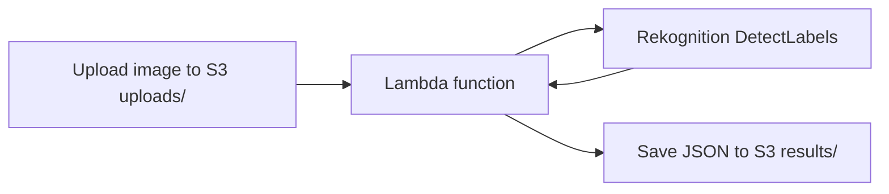
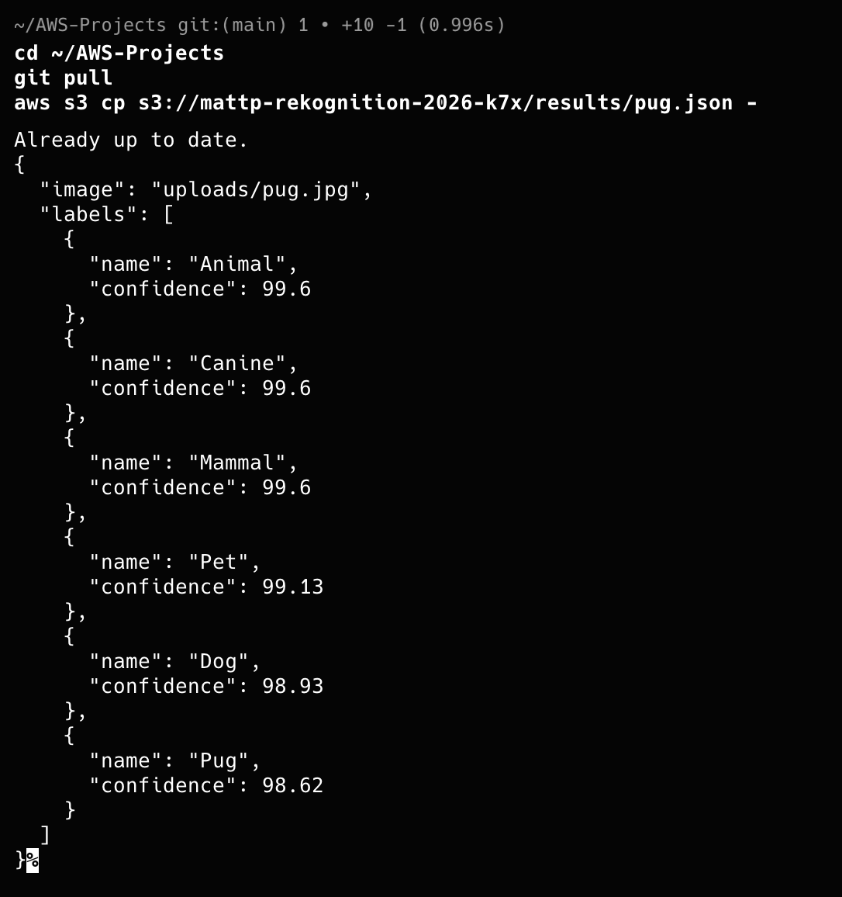

# Image Label Generator (S3, Lambda, Rekognition)

## What I built
A serverless pipeline that labels images automatically. Uploading an image to the `uploads/` folder of an S3 bucket triggers a Lambda function, which asks Amazon Rekognition to detect labels and saves the results as a JSON file in the `results/` folder.

## Architecture

## Key decisions
- **Least privilege:** the Lambda role can only read from `uploads/`, write to `results/`, and call Rekognition DetectLabels. It has no access to the rest of the bucket.
- **Avoiding a loop:** the function reads from one folder and writes to another, and the S3 trigger only watches `uploads/`. If results were written to the same place, each result would trigger the function again.
- **Timeout:** raised from the 3 second default to 15 seconds, because the call to Rekognition can take longer than 3 seconds.
- **Confidence threshold:** labels below 80% confidence are dropped, and the maximum is 10 labels.

## Example result
A photo of a pug returned labels including Animal, Mammal, Pet, Dog and Pug, with Pug at about 98.6% confidence.

## What went wrong and how I fixed it
Rekognition rejected my first test image. The file was named photo.jpg, but its contents were WebP, which Rekognition does not support (it accepts JPEG and PNG). Rekognition reads the file contents, not the extension. I converted the image to a real JPEG and it worked.

## Checking it works
I read the function's CloudWatch logs. Each run showed a START, END and REPORT line with no errors. The first run included a cold start, and the second ran faster because the container was already warm. Each run took under a second.

## Cost
Very small at this scale. I set a $5 monthly budget alert on the account and did not check pricing beyond that, so look up current Lambda, Rekognition and S3 pricing before relying on this.

## Cleanup
To avoid ongoing charges, delete the Lambda function, the IAM role, and empty and delete the S3 bucket.

## Files
- `lambda_function.py`: the function code
- `iam-policy.json`: the permissions policy attached to the function's role

## What I would improve next
- Store results in DynamoDB so they can be searched
- Add an alarm for function errors
- Define everything as code (CloudFormation or Terraform)
